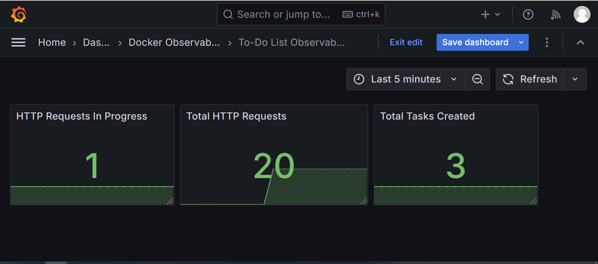

# Docker Observability with Prometheus and Grafana

A containerized monitoring project using Docker Compose, Prometheus, and Grafana.

## Architecture

- **Todo App:** Exposes application metrics.
- **Prometheus:** Collects and stores metrics.
- **Grafana:** Visualizes metrics through dashboards.

## Metrics

- `todo_tasks_created_total`
- `http_requests_received_total`
- `http_requests_in_progress`

## Technologies

- Docker
- Docker Compose
- Prometheus
- Grafana

## Run the Project

```bash
docker compose up -d

## Dashboard Preview

